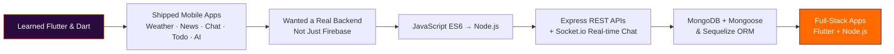

  

  

  
  
  
  

---

## 👋 About Me

I'm a **Junior Software Engineer** with 1+ year of hands-on experience building mobile apps with **Flutter & Dart** — Clean Architecture, MVVM, state management (Bloc/Cubit, Provider), and REST API integration.

My focus today is **backend engineering**. I started with Flutter only, and I'm now learning **JavaScript (ES6+ modules) → Node.js → Express → MongoDB/Mongoose** step by step, so I can build complete full-stack products instead of relying only on Firebase.

I don't just watch tutorials — I learn by **building real things**, and I comment my code heavily to make sure I understand every layer of the architecture.

<table>
<tr>
<td width="50%" valign="top">

### 🔭 Working on
- **Warehouse Management System** for a real cold-storage business (Excel workflow → Flutter + Node.js + MongoDB)
- **Saraha (صراحة)** — an app with my own Node.js + MongoDB backend *(planning & database design)*

### 🌱 Learning
- Node.js core modules (`events`, `fs`, ...)
- Express.js & REST API design
- MongoDB + Mongoose (schemas, models, relations)
- ORMs with Sequelize (SQL)

</td>
<td width="50%" valign="top">

### 💡 Fun facts
- 🧊 I turn real warehouse & cold-chain problems into software
- 🌍 Interested in offline-first apps for Arabic-speaking markets
- 🗣️ Comfortable in **Arabic & English**
- 🧠 Believe in understanding *why* the code works, not just copy-pasting it

### 💬 Ask me about
Flutter · Clean Architecture · Firebase · Node.js/Express basics

</td>
</tr>
</table>

---

## 🧭 The Journey So Far

---

## 🧰 Tech Stack

**📱 Mobile**

  
  
  
  
  
  
  
  

**⚙️ Backend (actively growing)**

  
  
  
  
  
  
  
  

**🛠️ Tools & Practices**

  
  
  
  
  
  
  

---

## 🚧 What I'm Building

| Project | Status | Stack | What it is |
|---|---|---|---|
| 🧊 **Warehouse Management System** | 🔄 In progress | Flutter · Node.js · Express · MongoDB | A real-world system for a cold-storage business — moving from an Excel workflow to a full-stack app (batch tracking, expiry alerts, FIFO logic) |
| 💬 **Saraha (صراحة)** | 📝 Planning & DB design | Node.js · MongoDB | An honesty app with a backend I'm designing and building myself |
| 📡 **Real-time Chat** | ✅ Built | Node.js · Socket.io | Real-time chat app, heavily commented to understand the architecture end-to-end |
| 🔧 **CRUD REST API** | ✅ Built | Node.js · Express | Full GET / POST / PUT / DELETE API |
| 🧪 **ColdTrack** | 📚 Practice project | JavaScript | Cold-chain inventory system built to lock in JavaScript fundamentals |

---

## 📱 Flutter Projects

| App | Highlights |
|---|---|
| 📖 [Islami App](https://github.com/Mohamed20186/islami_app) | Quran, Hadith & live Islamic radio · Cubit · localization · Dio |
| ⛅ [Weather App](https://github.com/Mohamed20186/weather_app) | MVVM · Cubit · Dio · search by country |
| 📰 [News App](https://github.com/Mohamed20186/newss_app) | Provider state management · real-time articles |
| 💬 [Chat App](https://github.com/Mohamed20186/chat_app) | MVVM · Cubit · Firebase Auth · Firestore real-time messaging |
| ✅ [Todo App](https://github.com/Mohamed20186/todo_app) | MVVM · Firebase Auth + Firestore · multi-language support |
| 🤖 Weather Prediction AI App | AI model + live weather API for forecasting and activity planning |
| 🥗 Meal Recommendation App | Gemini AI · meal plans based on goals & available ingredients |

---

## 🎯 Learning Roadmap

- [x] Flutter & Dart · Clean Architecture · MVVM
- [x] State management (Bloc/Cubit, Provider)
- [x] Firebase (Auth, Firestore)
- [x] JavaScript fundamentals (ES6+ modules)
- [x] Node.js + Express CRUD REST API
- [x] Real-time apps with Socket.io
- [ ] MongoDB + Mongoose in depth
- [ ] Authentication & Authorization (JWT)
- [ ] Validation, error handling & project structure
- [ ] Deploy a full-stack app (Flutter + Node.js + MongoDB)

---

## 📊 GitHub Stats

  
  

  

---

## 🤝 Open To

I'm looking for opportunities as a **Junior Flutter Developer** or **Junior Backend (Node.js) Developer**, and I'm open to **full-stack** roles where I can use both.

  <b>📍 Egypt &nbsp;•&nbsp; 📫 mohamed.work78@gmail.com</b>  
  

  

